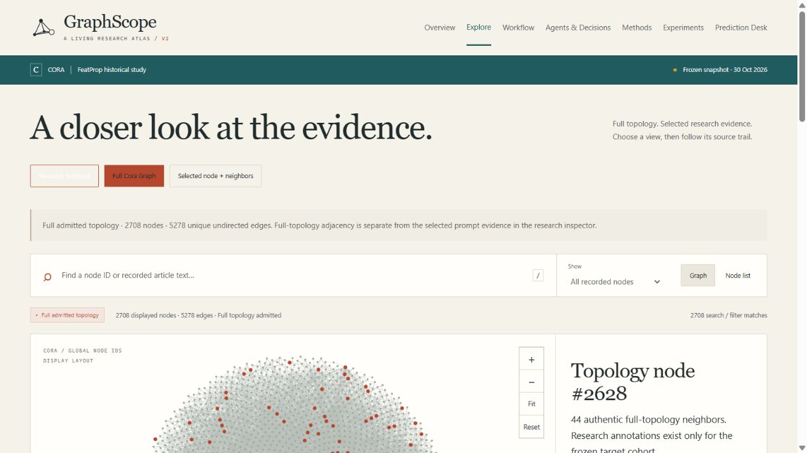
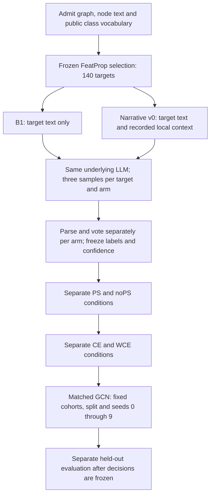
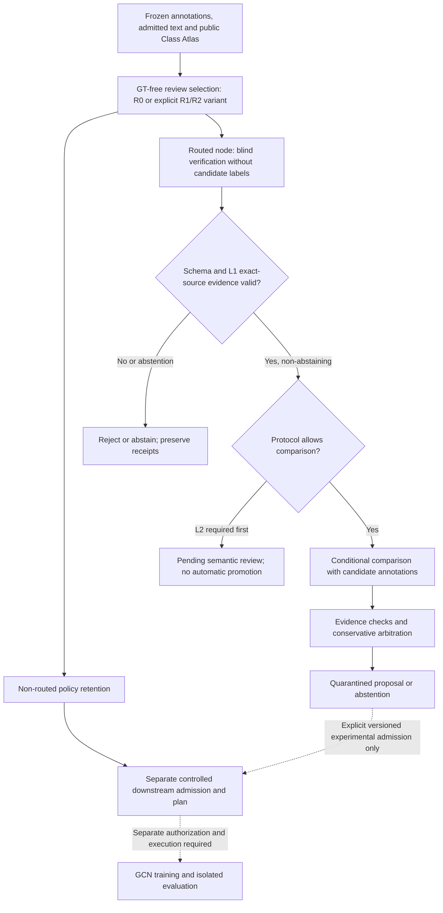
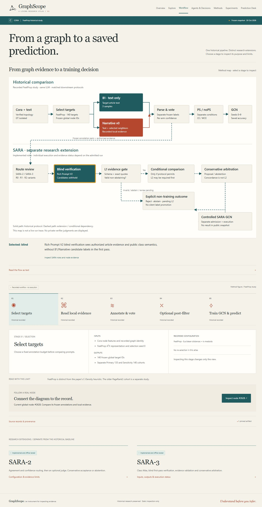

# LLM-GNN / SARA

**Ground-truth-free node annotation with language models, graph-aware evidence, and controlled downstream GNN evaluation.**

One evolving research repository connects the historical B1/Narrative experiments, recovered evidence, and reconstructed SARA extensions. **GraphScope** is the accompanying research website for inspecting graph structure, annotation evidence, method lineage, and saved results.

Status reviewed: **2026-11-06**. Historical experiments, synthetic software checks, and private live execution have distinct evidence levels. No SARA-3 downstream improvement is established here.

[Website](#graphscope-research-website) · [Workflow](#research-workflow) · [Results](#historical-results) · [Quick start](#quick-start) · [Architecture](#repository-map) · [Reproducibility](#reproducibility-and-scientific-boundaries)

**2026-11-07 experimental update:** [Three-agent Fusion P1/P2](docs/THREE_AGENT_FUSION_GCN.md)
combines B1, Narrative and frozen Agent3 evidence into one final label per node.
[Executed label-quality tables and the GCN plan matrix](docs/THREE_AGENT_FUSION_RESULTS.md)
separate coverage from corrections. GCN training/admission remains blocked pending
independent authorization and test audit; no downstream improvement is claimed.

## Research question and development path

Can an LLM annotate nodes in a text-attributed graph without access to ground-truth labels, and can local graph context and selective verification improve pseudo-labels and downstream GNN performance?

1. **Published foundation:** Chen et al., *Label-Free Node Classification on Graphs with Large Language Models (LLMs)*, ICLR 2024, motivates selection, confidence-aware annotation, filtering and GNN learning.
2. **Historical local baseline:** B1 annotates target text; Narrative v0 adds recorded local structural evidence. Both use the **same underlying LLM**, on matched target nodes. B1 is paper-inspired, not an exact paper B0 reproduction. FeatProp is distinct from C-Density.
3. **SARA-2:** agreement/confidence routing and an optional judge introduce conservative retention or abstention. Exact historical Policy 002 thresholds are not recovered; current defaults are explicit reconstruction choices.
4. **SARA-3:** public class knowledge, content-aware risk routing, blind verification, evidence validation, conditional comparison and conservative arbitration extend the research design.
5. **Recovery and implementation:** the former Codex-era D-drive source is lost. The active package is reconstructed from the pre-Codex Drive/Colab archive and pinned evidence, with offline checks and frozen parsed-sample replay.
6. **Scientific endpoint:** freeze eligible pseudo-labels, then evaluate GCN under matched protocols. Better accepted-label accuracy alone is insufficient: retention and class coverage matter.

The [scientific protocol](docs/SCIENTIFIC_PROTOCOL.md) separates the published method, proposal, historical protocol, and reconstruction. Uniform2Path3 is not a literal random walk.

## GraphScope research website



GraphScope has seven views: **Overview, Explore, Workflow, Agents & Decisions, Methods, Experiments, and Prediction Desk**. It is a static React/TypeScript/Vite/Cytoscape interface; the browser does not run annotation, training, or private research imports.

| Evidence layer | Scope |
|---|---|
| Full admitted Cora topology | 2,708 nodes and 5,278 unique undirected edges |
| Research evidence subset | 140 target nodes, 338 context nodes, 525 recorded neighborhood edges |
| Frozen annotations | 280 target-arm outputs; three stored parsed samples per target/arm |
| Historical main GCN study | Eight conditions, ten paired seeds each, 160 fits |
| Missing verifier judgments | Explicitly unavailable; synthetic fixtures are excluded from production evidence |

The full topology and selected prompt-evidence subgraph are different layers. SHA-256 pins and strict schemas protect the exported JSON. See [frontend documentation](web/graphscope/README.md) and [topology recovery](web/graphscope/TOPOLOGY_RECOVERY.md).

Screenshots were copied from existing local QA captures and visually inspected for this update. They show a local working-tree preview, including frontend changes outside this documentation commit; they do not certify the committed frontend or a public deployment. See [image provenance](docs/assets/README.md).

### Run the website

Use Node.js 24 and pnpm 11.25.0. Installation needs network access unless dependencies are cached.

```sh
cd web/graphscope
pnpm install --frozen-lockfile --ignore-scripts
pnpm dev
```

Open **http://127.0.0.1:5173/LLM-GNN/**. Production checks and preview:

```sh
pnpm test
pnpm build
pnpm preview
```

Preview defaults to **http://127.0.0.1:4173/LLM-GNN/**. With dependencies already installed, `node node_modules/vite/bin/vite.js --host 127.0.0.1` also starts development mode.

The [manual GitHub Pages workflow](.github/workflows/graphscope-pages.yml) validates and publishes the frontend only when explicitly dispatched; it does not deploy on push. **Public deployment availability was not verified by this documentation update.**

## Research workflow

### Historical matched B1 / Narrative study



The current offline replay re-votes **280 target-arm decisions from 840 stored parsed samples**. It does not issue LLM requests, parse missing raw responses, or rerun historical GCN training.

### SARA-3 extension and acceptance boundaries



This is an interface/process diagram, not a completed live trace. SARA-2 remains a distinct routing/judge implementation.

| Stage | Purpose | Scientific limit |
|---|---|---|
| Class Atlas | Public class definitions and comparison knowledge | No GT, correctness flags or diagnostic confusion matrices |
| R0 / R1 / R2 | Versioned risk selection and review budget allocation | Offline variants do not establish superiority |
| Blind verifier | Inspect evidence before seeing B1/Narrative candidates | Synthetic fixtures and provider-backed observations stay separate |
| L1 gate | Validate schemas, source identity and exact quotations | Structural validity is not semantic correctness |
| L2 assessment | Assess semantic support of evidence and claims | Automatic concordance does not constitute L2 approval |
| Arbitration | Conservative retention, proposal or abstention | Routed proposals are not automatically training labels; third-class correction is experimental |
| Durable runner | Persist intents, receipts, usage and dependencies | REJECTED/UNCERTAIN intents never automatically retry |
| Downstream plan | Preserve matched cohorts, losses and seeds | A plan or synthetic forward is not completed training |

<details>
<summary>Saved website workflow screenshot</summary>



</details>

## Historical results

These are **frozen historical outcomes**, not newly executed training, SARA-3 results, or a direct comparison with the published paper. Sources: [scientific protocol](docs/SCIENTIFIC_PROTOCOL.md) and [reviewed website data](web/graphscope/public/data/atlas.v2.json).

The central matched study uses Cora, 140 frozen FeatProp targets, Primary135 complete cases and Sensitivity140. The shared **2,568-node test set** is the complement of the entire selected140 pool. Excluded, post-filtered or abstained targets never move into test.

| Cohort / loss / filtering | B1 GCN accuracy (%) | Narrative v0 GCN accuracy (%) | Paired mean gain (pp) |
|---|---:|---:|---:|
| Primary / CE / noPS | 69.680685 ± 0.411816 | 70.954050 ± 0.412644 | +1.273364 |
| Primary / WCE / noPS | 70.486760 ± 0.322739 | 72.671340 ± 0.528448 | +2.184579 |
| Sensitivity / CE / noPS | 69.844237 ± 0.404385 | 71.732866 ± 0.458593 | +1.888629 |
| Sensitivity / WCE / noPS | 70.595794 ± 0.344555 | 73.165888 ± 0.448564 | +2.570093 |

Values are mean ± population SD over ten paired training seeds (`ddof=0`). This SD does not measure uncertainty across independent LLM annotation runs. The four rows are the noPS subset of the eight-condition, **160-fit** main study; PS conditions remain separately inspectable in GraphScope.

Historical GCN settings: two layers, hidden size 64, dropout 0.5, Adam learning rate 0.01, weight decay 0.0005, exactly 30 epochs, final checkpoint, no validation/early stopping, seeds 0–9. Confidence-weighted CE uses `mean(CE_i * w_i)` and the frozen min-max confidence contract, not division by the sum of weights.

These results motivate SARA research. They do not demonstrate SARA correction benefit or generalization. Cora/CiteSeer are development/diagnostic datasets; confirmatory claims need an untouched cohort/dataset or explicit exploratory labeling.

## Current execution status

The implementation reference before this README update is **`f75d2e4`**, which freezes a proposed eight-node continuation amendment with offline scope guards.

- The private Rich V2/4096 run was **owner-reported halted** after 53 attempts: 52 COMPLETED, one REJECTED, zero UNCERTAIN. Node 1814 / comparison failed with `L1_DUPLICATE_EVIDENCE`.
- These counts are recorded in documentation and the registry. This README task did not reconcile private journals or usage receipts. COMPLETED is an execution/L1 state, not proof of a correct class.
- The halted run remains blocked. The proposed amendment covers eight never-dispatched Blind nodes, at most 16 new logical calls and 69 cumulative calls within the original 74-call cap. **The proposal is not dispatch or spending authorization.**
- This documentation update makes no provider calls, accesses no GT, performs no real training, and changes no L1, routing, arbitration or protected historical artifacts.

See [live adapter, halt and continuation record](docs/SARA3_GAPGPT_LIVE_ADAPTER.md), [proposed amendment](configs/sara3_gapgpt_continuation_amendment_v1.json), [project state](PROJECT_STATE.md), and [experiment registry](EXPERIMENT_REGISTRY.jsonl). Older preparatory commands are historical records, not permission to restart halted runs.

## Quick start

### Offline demonstration

Python **3.10+**; the core offline package has zero third-party runtime dependencies. From the root in PowerShell:

```powershell
$env:PYTHONPATH = Join-Path $PWD 'src'
python -B -m llmgnn_sara doctor
python -B -m llmgnn_sara sara3-offline --demo
```

The demo is explicitly synthetic. `doctor` reports local dependencies and top-level offline CLI boundaries; it is not a whole-repository provider audit or a scientific validation. An editable installation using existing setuptools >=61 is also supported:

```powershell
python -m venv --system-site-packages .venv
.\.venv\Scripts\python.exe -m pip install --no-index --no-deps --no-build-isolation -e .
.\.venv\Scripts\python.exe -B -m llmgnn_sara doctor
```

### Replay admitted historical samples

Restore the exact external files listed in [frozen artifacts](manifests/frozen_artifacts.json) under `.local_artifacts/frozen/`. A clean clone does not include the private research archive.

```powershell
$env:PYTHONPATH = Join-Path $PWD 'src'
$inputs = @('--b1', '.local_artifacts/frozen/b1_final_predictions.json',
            '--narrative', '.local_artifacts/frozen/narrative_v0_final_predictions.json',
            '--selection', '.local_artifacts/frozen/selection_manifest.json')
python -B -m llmgnn_sara replay-frozen @inputs
python -B -m llmgnn_sara pipeline @inputs --cohort primary --loss wce
python -B -m llmgnn_sara gcn-plan @inputs --arm both --loss ce
```

Replay compares classes/fallbacks exactly and confidence within `1e-12`. Pipeline stops on a baseline mismatch. Without target text, selected reviews abstain; policy-retained agreements are not verifier corrections. `gcn-plan` never trains.

For authentic text/context admission, durable offline execution and optional environments, consult [pilot protocol](docs/PILOT_PROTOCOL.md), [Rich V2 runner](docs/SARA3_RICH_RUNNER.md), [offline routing experiment](docs/OFFLINE_ROUTING_EXPERIMENT.md), and the [earlier operational reference](docs/OFFLINE_OPERATIONS.md). That reference preserves older commands/statuses; the newer halted-run constraints above take precedence.

### Verification

```powershell
$env:PYTHONPATH = Join-Path $PWD 'src'
python -B -m unittest discover -s tests -v
```

Some pilot suites require private sealed artifacts; a public clone cannot establish their success. [Offline CI](.github/workflows/sara3-offline-regression.yml) explicitly lists these exclusions. Previous reports are scoped records, not tests rerun by this documentation change.

Torch/PyG and tiktoken are optional. See [tested environment](configs/offline_tested_environment.json) and [CPU dependency pins](configs/offline_cpu_requirements.txt). Synthetic GCN forward checks do not validate real training or historical numeric parity. Tokenizer initialization may download vocabulary; offline tests require existing cache.

## Repository map

```text
src/llmgnn_sara/       Active integrated Python package
  annotation/         B1/Narrative adapters, parser and frozen replay
  selection/          Frozen target selection contracts
  filtering/          Post-selection and class-coverage safeguards
  sara2/              Reconstructed agreement/confidence policy and judge
  sara3/              Routing, class knowledge, evidence, arbitration, durable runner
  pilot/              Authentic input preparation and scoped pilot infrastructure
  downstream/         Matched GCN plans and guarded model/training backend
  evaluation/         Isolated evaluation and experiment analysis
  io/                 Artifact admission and serialization
web/graphscope/       Static research website and reviewed JSON exports
configs/              Protocols, environments and proposed contracts
manifests/            Hash pins, source lineage and restoration metadata
tests/                Offline tests and synthetic fixtures
scripts/              Recovery and supporting utilities
reports/              Scoped verification and analysis records
docs/                 Scientific/operational guides and documentation images
recovered_sources/    Read-only pre-Codex evidence, not a second active codebase
EXPERIMENT_REGISTRY.jsonl
PROJECT_STATE.md
```

## Reproducibility and scientific boundaries

| Provenance | Meaning |
|---|---|
| `RECOVERED_EXACT` | Original bytes independently match an admitted source hash |
| `RECONSTRUCTED` | Implementation/document recreated from evidence |
| `REPRODUCED` | Recomputed by a documented execution within a stated scope |
| `UNVERIFIED` | Not independently confirmed |

Parsed replay is not raw-body parsing. Raw provenance remains partial until required original responses are independently hash-admitted. Frozen labels, manifest references and report assertions cannot substitute for missing raw bytes. See [raw recovery instructions](docs/RAW_RESPONSE_RECOVERY.md). Do not execute historical `startup.py`, import unreviewed scripts, or unpickle untrusted graph/model files.

Preserve raw outputs, official splits, frozen configurations, completed evaluations and historical receipts. Annotation runtime may use text, authorized graph context and public class semantics; **GT labels, correctness flags, confusion matrices and test outcomes must not enter prompts, routing, class-knowledge generation or acceptance rules**. Protocol-authorized training labels belong only in the separate supervised training boundary. Never tune prompts, thresholds or selection on final-test outcomes or previously inspected Cora GT.

## Execution, privacy and backups

- **Paid inference:** separate explicit spending authorization, exact frozen inputs/configuration, compatibility/privacy review, cost estimates and durable receipts are required. Estimates are not guaranteed billing caps. Credentials never belong in Git, chat, screenshots or reports.
- **Failures:** preserve terminal REJECTED/UNCERTAIN records. Never reset journals, silently deduplicate historical invalid evidence, or automatically retry a halted request.
- **Training:** real GCN training and GT evaluation require separate authorization and execution; generated plans are not completed experiments.
- **GitHub:** the remote observed for this update is `https://github.com/Parand1khalili/LLM-GNN.git`. Local commits remain **PUSH_PENDING** until independent remote SHA verification. The owner normally pushes manually; never push to `CurryTang/LLMGNN`.
- **Google Drive:** preserve `Prnd-project` read-only. Code and small documentation assets belong in Git; approved research artifacts need independent incremental Drive backup with hashes and readback verification. This update performs no Drive upload or recovery-readiness verification.
- **Attribution:** recovered code/data retain upstream licensing and attribution constraints; this repository does not grant new redistribution rights over those materials.

## Next scientific step

Reconcile existing halted-run receipts locally with the read-only tools, preserve the rejection, and review the frozen continuation proposal before any separately authorized execution. Freeze eligible annotation decisions before a controlled downstream experiment measures accuracy, retention and class coverage.
